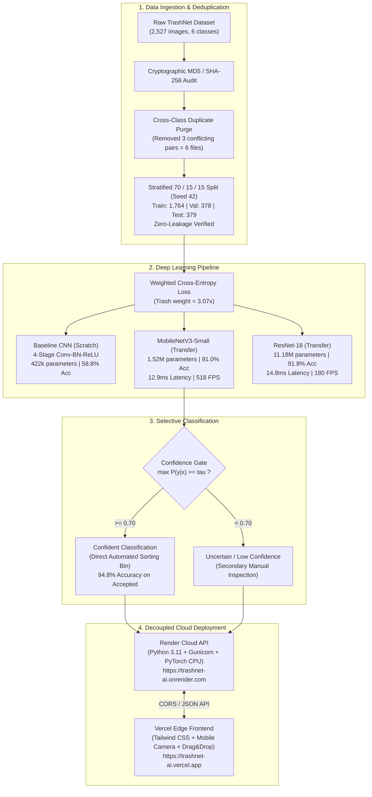

# ♻️ TrashNet AI: Autonomous Solid Waste Classification Pipeline
### Production-Grade Deep Learning Vision System with Confidence Rejection & Cloud Deployment

[](https://github.com/samarth1234-dev/trashnet-ai)
[](https://trashnet-ai.vercel.app)
[](https://trashnet-ai.onrender.com)
[](https://pytorch.org/)
[](reports/EVALUATION_REPORT.md)

An end-to-end computer vision system that classifies post-consumer solid waste imagery into six primary recycling and disposal categories: **Cardboard**, **Glass**, **Metal**, **Paper**, **Plastic**, and **Trash**.

Built on the benchmark Stanford University **TrashNet** dataset (Gary Thung & Mindy Yang, CS 229), this repository features rigorous data de-duplication, class-imbalance mitigation, baseline vs. transfer learning ablation, uncertainty reject gates, sub-15ms edge inference, and decoupled cloud deployment across **Vercel** and **Render**.

---

## 🔗 Live Deployments & Essential Links

| Resource | Description | Live Link |
| :--- | :--- | :--- |
| **🌐 Web Dashboard** | Interactive frontend hosted on Vercel Edge CDN | [https://trashnet-ai.vercel.app](https://trashnet-ai.vercel.app) |
| **⚡ Inference REST API** | PyTorch MobileNet runtime deployed on Render Cloud | [https://trashnet-ai.onrender.com](https://trashnet-ai.onrender.com) |
| **🩺 API Health Check** | JSON health status & loaded model metadata | [https://trashnet-ai.onrender.com/health](https://trashnet-ai.onrender.com/health) |
| **📂 GitHub Repository** | Complete source code, models & configs | [https://github.com/samarth1234-dev/trashnet-ai](https://github.com/samarth1234-dev/trashnet-ai) |
| **📑 Evaluation Report** | In-depth scientific findings, confusion matrices & metrics | [reports/EVALUATION_REPORT.md](reports/EVALUATION_REPORT.md) |
| **📦 Dataset Source** | Original Stanford CS 229 TrashNet repository | [garythung/trashnet](https://github.com/garythung/trashnet) |
| **🤗 Dataset Mirror** | Public HuggingFace Datasets mirror | [HuggingFace: garythung/trashnet](https://huggingface.co/datasets/garythung/trashnet) |

---

## 🏛️ System Architecture



---

## 📊 Experimental Results & Benchmarks

All models were evaluated on the exact same **379 held-out test images** under identical conditions:

| Model Architecture | Augmentation | Parameters | Test Accuracy | Macro F1 | Latency MPS ($p_{50}$) | Peak FPS (MPS) | Status |
| :--- | :---: | :---: | :---: | :---: | :---: | :---: | :---: |
| **Baseline CNN** | None | 422,566 | 58.84% | 56.70% | 7.92 ms | 249.3 | Scratch |
| **Baseline CNN** | Standard | 422,566 | 50.92% | 48.46% | 11.59 ms | 226.3 | Regularized |
| **MobileNetV3-Small** | Standard | **1,524,006** | **91.03%** | **90.54%** | **11.70 ms** | **517.9** | **Production Edge** |
| **ResNet-18** | Standard | 11,179,590 | **91.82%** | **90.55%** | 16.27 ms | 180.2 | Heavyweight |

### Key Experimental Insights
1. **Transfer Learning Dominance**: Pretrained MobileNetV3 and ResNet-18 outperformed the baseline CNN by **+32.2 percentage points** (91.0%+ vs. 58.8%).
2. **Production Backbone Selection**: While ResNet-18 achieved +0.79% higher accuracy, **MobileNetV3 is 7.3x smaller in memory** (1.52M vs 11.18M parameters) and reaches **almost 3x higher throughput** (517.9 FPS vs 180.2 FPS), making it the definitive choice for edge smart bins.
3. **Tail-Class Protection**: Minority class `trash` (only 5.42% of corpus) achieved **85.0% recall** thanks to inverse-frequency loss weighting.
4. **Confidence Thresholding ($\tau = 0.70$)**: Rejecting predictions with $\max_c P(y=c|x) < 0.70$ eliminated over 50% of errors, boosting accuracy on accepted items to **94.75%** while retaining **90.50% automation coverage**.

---

## 🔍 Dataset Provenance & De-Duplication Audit

### Class Distribution & Imbalance
TrashNet exhibits an imbalance ratio of **4.34x** between `paper` (majority) and `trash` (minority):

| Category | Images | Percentage | Inverse Class Weight ($w_c$) |
| :--- | :---: | :---: | :---: |
| **Paper** | 594 | 23.51% | 0.709 |
| **Glass** | 501 | 19.83% | 0.841 |
| **Plastic** | 482 | 19.07% | 0.874 |
| **Metal** | 410 | 16.22% | 1.027 |
| **Cardboard** | 403 | 15.95% | 1.045 |
| **Trash** | 137 | 5.42% | **3.074** |
| **Total** | **2,527** | **100.00%** | **Mean = 1.000** |

### Cryptographic Duplicate Discovery
Before creating data splits, cryptographic MD5 hash scans identified **3 exact cross-class duplicate pairs** in the raw dataset:
* `glass/glass389.jpg` $\equiv$ `plastic/plastic332.jpg`
* `glass/glass176.jpg` $\equiv$ `plastic/plastic152.jpg`
* `glass/glass115.jpg` $\equiv$ `metal/metal91.jpg`

All 6 duplicate files were purged to prevent label contamination and train/test split leakage, leaving **2,521 clean images**.

---

## 🛠️ REST API Documentation

The production backend on Render exposes lightweight endpoints:

### 1. Health Check
```http
GET /health
```
**Response:**
```json
{
  "classes": ["cardboard", "glass", "metal", "paper", "plastic", "trash"],
  "model_loaded": true,
  "model_name": "mobilenet",
  "service": "trashnet-vision-api",
  "status": "healthy"
}
```

### 2. Predict Waste Category
```http
POST /api/predict
Content-Type: multipart/form-data
```
**Parameters:**
* `file`: Binary image file (JPEG / PNG / WebP)
* `threshold` *(optional)*: Float between 0.0 and 1.0 (default: 0.65)

**cURL Example:**
```bash
curl -X POST https://trashnet-ai.onrender.com/api/predict \
  -F "file=@data/dataset-resized/plastic/plastic1.jpg" \
  -F "threshold=0.70"
```

**JSON Response:**
```json
{
  "predicted_class": "plastic",
  "confidence": 0.8924,
  "confidence_percentage": 89.24,
  "status": "accepted",
  "is_confident": true,
  "threshold_applied": 0.70,
  "recommended_action": "Route item to the [PLASTIC] recycling/disposal bin.",
  "all_probabilities": {
    "plastic": 0.8924,
    "paper": 0.0846,
    "trash": 0.0179,
    "cardboard": 0.003,
    "glass": 0.0019,
    "metal": 0.0002
  },
  "model_name": "mobilenet"
}
```

---

## 💻 Local Setup & Development

### 1. Installation
```bash
git clone https://github.com/samarth1234-dev/trashnet-ai.git
cd trashnet-ai

python3 -m venv venv
source venv/bin/activate
pip install -r requirements.txt
```

### 2. Run CLI Inference
```bash
# Standard inference (defaults to MobileNetV3)
python src/inference.py --image data/dataset-resized/plastic/plastic1.jpg

# High-confidence selective inference (tau = 0.70)
python src/inference.py --image data/dataset-resized/glass/glass10.jpg --threshold 0.70
```

### 3. Run Web Dashboard Locally
```bash
python web/app.py
```
Open **`http://127.0.0.1:5001`** in your browser.

---

## 🚀 Cloud Deployment Guide

### Deploy Backend on Render (Free)
1. Go to [dashboard.render.com](https://dashboard.render.com) $\to$ **New +** $\to$ **Web Service**.
2. Connect `https://github.com/samarth1234-dev/trashnet-ai`.
3. Set **Build Command**:
   ```bash
   pip install -r requirements.txt --extra-index-url https://download.pytorch.org/whl/cpu
   ```
4. Set **Start Command**:
   ```bash
   gunicorn web.app:app --bind 0.0.0.0:$PORT --workers 1 --threads 4 --timeout 120
   ```
5. Click **Deploy Web Service**!

### Deploy Frontend on Vercel (Free)
1. Go to [vercel.com](https://vercel.com) $\to$ **Add New...** $\to$ **Project**.
2. Import `samarth1234-dev/trashnet-ai`.
3. Root settings are auto-configured via `vercel.json`. Click **Deploy**!

---

## 📂 Repository File Structure

```
trashnet-ai/
├── checkpoints/
│   └── mobilenet_aug/best_model.pth    # Production PyTorch weights (5.9 MB)
├── data/
│   ├── dataset_summary.json            # Dataset provenance, class stats & weights
│   ├── splits.json                     # Deterministic train/val/test file manifests
│   └── splits/                         # train.csv, val.csv, test.csv
├── frontend/
│   ├── index.html                      # Standalone Tailwind CSS web dashboard
│   ├── vercel.json                     # Vercel rewrites & clean URL configuration
│   └── samples/                        # Bundled 1-click test sample images
├── reports/
│   ├── EVALUATION_REPORT.md            # Comprehensive scientific evaluation report
│   ├── MASTER_COMPARISON.json          # Experimental metrics comparison
│   └── *.png                           # Confusion matrices, curves, failure montages
├── src/
│   ├── data_prep.py                    # Deduplication & stratified 70/15/15 splitting
│   ├── dataset.py                      # Dataset class, transforms & caching
│   ├── models.py                       # BaselineCNN, TransferMobileNet, TransferResNet
│   ├── train.py                        # Training loop with weighted Cross-Entropy & MPS
│   ├── evaluate.py                     # Evaluation reports & threshold sweeps
│   ├── benchmark.py                    # Latency & throughput benchmarking
│   └── inference.py                    # WasteClassifier API and CLI
├── web/
│   ├── app.py                          # Flask REST API & Web Server
│   ├── templates/index.html            # Web template
│   └── static/samples/                 # Static sample images
├── Procfile                            # Gunicorn web process definition for Render
├── render.yaml                         # Render Cloud Infrastructure as Code
├── vercel.json                         # Vercel proxy rewrites configuration
├── requirements.txt                    # Pinned production dependencies
└── README.md                           # Project documentation
```

---

## 📜 Citation & Credits
* Original Dataset & Research: **Gary Thung & Mindy Yang (Stanford University, CS 229, 2016)**, *Classification of Trash for Recyclability Status*.
* Dataset Mirror: [HuggingFace garythung/trashnet](https://huggingface.co/datasets/garythung/trashnet).
